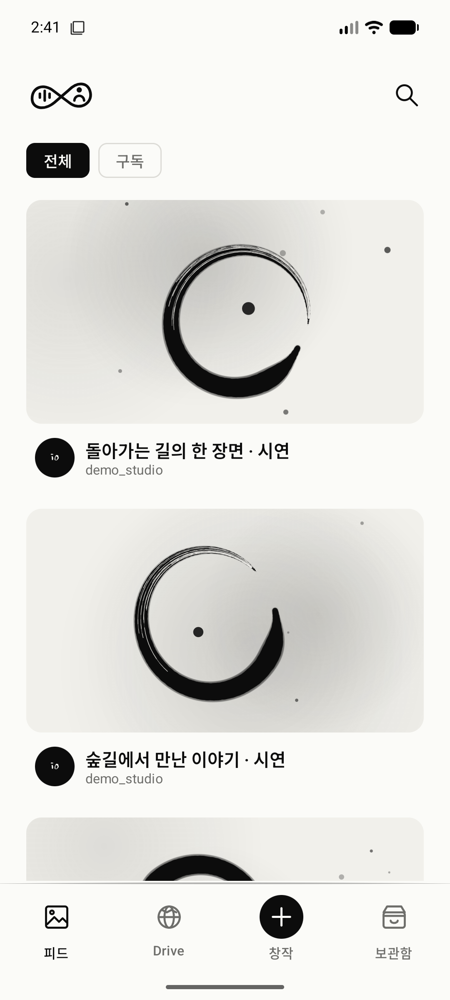
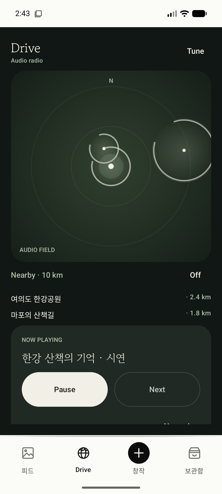
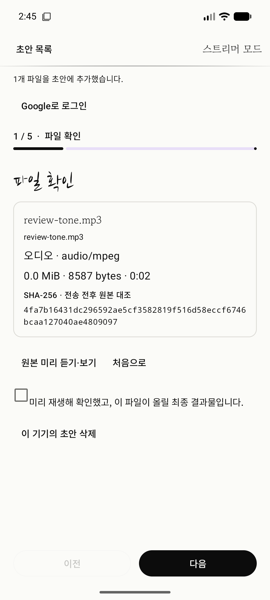
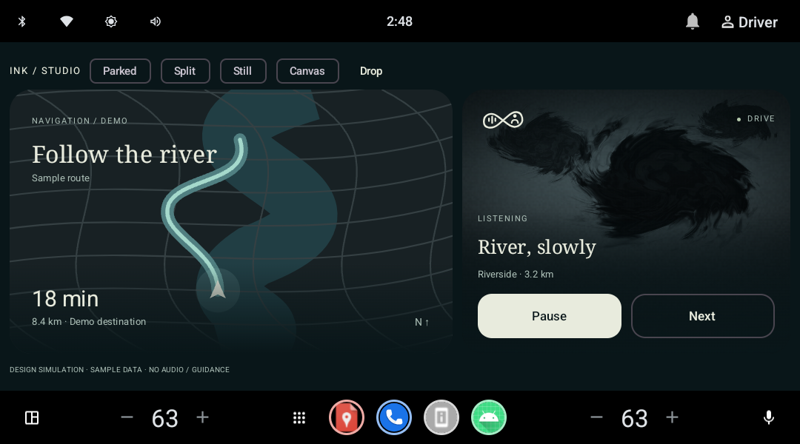

# AI & ME

**장소에 연결된 사람들의 추억과 창작물을 오디오로 발견하고 경험하는 플랫폼**

같은 강변을 걸어도 누군가에게는 여행의 기억이고, 누군가에게는 한 편의 이야기입니다.
AI & ME는 그 장소에 연결해 공유한 오디오를 다른 사람이 주변에서 발견하고 들을 수 있도록 만드는 Android 앱입니다.
크리에이터가 완성한 AI 오디오와 이야기를 올리고, 청취자는 피드와 선택적 위치 탐색을 통해 새로운 작품을 만납니다.

첫 출시는 **오디오 공유·발견·청취**에 집중합니다. 장소는 작품을 찾는 단서이고, 자동차는 이동 중 그 이야기를 듣는 경험으로 확장하려는 무대입니다.

**팀 앤드위브AI** · [실제 실행 화면](#실제-앱은-이렇게-동작합니다) · [차량용 디자인](#차량에서는-이동을-이야기와-연결합니다) · [개발 현황](#현재-구현과-다음-단계)

## 이런 순간을 만들고 싶습니다

여행자가 강변에서 느낀 감정을 오디오로 완성해 장소와 함께 공유합니다.
나중에 그 길을 걷는 사람은 주변 탐색에서 그 작품을 발견하고, 이어폰으로 다른 사람의 시선과 이야기를 듣습니다.
마음에 든 크리에이터를 구독하고 작품을 보관해, 장소를 떠난 뒤에도 다시 들을 수 있습니다.

이것이 우리가 만들고 싶은 경험입니다. **익숙한 장소를 다른 사람의 기억과 창작을 통해 새롭게 만나는 것**입니다.
위 예시는 서비스의 활용 시나리오이며, 아래 화면의 콘텐츠는 이를 설명하기 위한 시연 데이터입니다.

## 실제 앱은 이렇게 동작합니다

<table>
  <tr>
    <th>1 · 작품 발견</th>
    <th>2 · 주변 이야기 청취</th>
    <th>3 · 창작물 공유 준비</th>
  </tr>
  <tr>
    <td></td>
    <td></td>
    <td></td>
  </tr>
  <tr>
    <td>피드에서 작품을 찾고 검색합니다. 관심 크리에이터의 작품은 구독으로 이어 봅니다.</td>
    <td>내 주변을 켜면 장소에 연결된 오디오 영역이 나타납니다. Play로 주변 오디오부터 이어 듣습니다.</td>
    <td>완성한 오디오·ZIP을 가져와 원본을 미리 듣고 정보·권리·장소를 확인한 뒤 검수를 요청합니다.</td>
  </tr>
</table>

**2026-11-15 Pixel 8 에뮬레이터에서 실행해 촬영한 화면입니다.** 합성 목업 이미지가 아닙니다.
장소·제목은 합성 시연 데이터이며 실제 이용자의 추억이나 이동 기록이 아닙니다.
재생 음원은 Media3 공개 테스트 파일로, 화면 제목에 해당하는 추억 녹음이나 AI 생성 음원을 의미하지 않습니다.
창작 화면은 테스트 음원을 가져온 초안 단계이며 제출·승인 완료 장면은 아닙니다.

▶ **[주변 오디오 실제 실행 영상 보기 · 약 12초 · 무음 MP4](docs/media/phone-nearby.mp4)**

영상에는 위치 검색으로 표시된 영역과 NOW PLAYING 상태가 담겨 있습니다. GitHub에서 재생이 열리지 않으면 영상 파일을 다운로드해 볼 수 있습니다.

### 위치가 더해지면 무엇이 달라지나요

작품은 제목뿐 아니라 **공개 장소·주변 반경·지역 캐릭터·이야기**와 연결할 수 있습니다.
청취자는 현재 위치 주변의 승인된 작품을 찾습니다. Drive 화면의 크기가 다른 원은 작품에 연결된 장소와 범위를 표현합니다.
촬영에서는 한강공원 주변의 시연 좌표를 사용해 3개의 오디오 영역을 확인했습니다.

| 이용자 | 할 수 있는 일 | 만들고 싶은 가치 |
| --- | --- | --- |
| 추억을 나누는 사람 | 완성한 오디오에 장소와 이야기를 연결해 제출 | 개인의 기억이 다른 사람에게 새로운 장소 경험이 됨 |
| 크리에이터 | 지역을 배경으로 한 AI 오디오·창작물을 공유 | 검색과 주변 탐색에서 작품을 발견할 접점이 늘어남 |
| 청취자 | 주변 오디오를 찾고 재생·구독·보관 | 같은 공간을 다양한 사람의 시선으로 경험 |
| 지역 방문자 | 풍경과 연결된 이야기·캐릭터를 발견 | 장소를 지나치는 시간을 이야기와 만나는 시간으로 확장 |

위치 사용은 선택입니다. 위치를 거부해도 피드·검색·재생을 사용할 수 있습니다.
현재는 스마트폰의 전경 위치를 사용하고, 주변 탐색을 끄거나 해당 화면을 떠나면 위치 요청을 중단합니다.
[위치 동작과 구현 범위](docs/nearby-discovery.md)

### 공유는 간단하게 시작하고 제출은 자세하게 확인합니다

크리에이터 모드는 하단 **+ 창작**에서 열립니다.
MP3·M4A 또는 ZIP을 가져와 **파일 확인 → 콘텐츠 정보 → 권리 확인 → 장소 연결 → 최종 검토** 순서로 준비합니다.
현재 오디오 최대 길이는 **20분**입니다. AI 생성 표시와 사용 도구, 권리자·이용 근거를 입력하고 원본을 미리 확인합니다.

승인된 크리에이터가 제출한 작품은 검사·운영자 검수를 거쳐 공개하도록 설계했습니다.
신고·차단·공개 중단·계정 삭제와 동의 기록도 구현했습니다.
앱은 외부에서 완성한 오디오를 공유하는 플랫폼이며, 앱 안에서 오디오를 생성하는 모델을 제공하지는 않습니다.
[업로드와 검수 안내](docs/creator-uploads.md)

## 차량에서는 이동을 이야기와 연결합니다

이동 경로 주변의 작품을 듣는 경험으로 확장하고자 합니다.
목표는 운전 중 긴 글을 읽거나 화면을 계속 탐색하는 부담을 줄이고, 지역의 이야기와 창작물을 소리로 만나는 것입니다.

**위 화면은 AAOS 에뮬레이터에서 실행한 debug 전용 Ink Studio 디자인 시뮬레이션입니다.**
먹물이 물에 퍼지는 듯한 움직임과 내비게이션 옆 패널 구성을 탐색합니다.
지도·경로·작품명은 샘플이며 이 화면 자체는 실제 길 안내·추천·오디오 재생을 수행하지 않습니다.
현대차 실차 탑재 또는 OEM 제휴가 완료됐다는 의미는 아닙니다.

▶ **[차량용 먹물 애니메이션 실제 실행 영상 · 약 12초 · 무음 MP4](docs/media/vehicle-ink.mp4)**

차량 GPS 연결, 차량↔스마트폰 위치 전환, 개인화 추천, 실제 차량 플랫폼에 맞춘 화면 제공은 후속 개발 범위입니다.
플랫폼이 허용하는 미디어 UI와 OEM 전용 화면을 구분해 검증할 계획입니다.
[차량 디자인·오디오 우선 설계](android/docs/audio-first-drive.md) · [먹물 프로토타입](android/docs/ink-water-prototype.md)

## 현재 구현과 다음 단계

이 저장소는 **실행 가능한 개발 프로토타입**입니다. 위치를 통한 발견과 사람들의 창작물 공유라는 방향을 유지하면서, 첫 공개 서비스는 오디오에 집중합니다.
쇼츠·게시글은 후속 확장을 위해 기존 코드를 보존한 상태이며 기본 공개 기능에서는 제외했습니다.

| 영역 | 현재 구현 | 다음 단계 |
| --- | --- | --- |
| 청취 경험 | 피드·검색·재생·구독, 기기 내 보관 목록·기록 | 실기기 장시간 청취·통신 전환·접근성 검증 |
| 장소 연결 | 공개 장소·이야기 입력, 전경 위치 주변 검색, 오디오 영역 표현 | 실제 콘텐츠 확보·사용성 평가 |
| 크리에이터 | 앱·웹 초안, ZIP 검증, 원본 확인, 제출·검수 | 업로드 중단·종료·만료 복구 검증 보강 |
| 서버 검사 | 파일 크기·해시, ffprobe/FFmpeg 검사 규칙, 작업 상태·재시도, 검사 전 승인 차단 | 검사 큐·컨테이너·인증된 결과 전달의 운영 연결 |
| 서비스 운영 | 신고·차단·삭제·동의, 용량 한도·요청 제한 | 실제 회사 정책·관리자 보안·경보·복구 |
| 차량 경험 | 미디어 서비스와 AAOS 디자인 시뮬레이션 | OEM API·실차 검증·추천 알고리즘 연결 |

실제 운영 서버·Google OAuth·회사 정책 문서와 서명 AAB·Play 심사 준비는 별도 진행 중입니다.
개인화 추천 설계와 OEM 연동 완료를 현재 성과로 표시하지 않습니다.
보관함·프로필·청취 기록의 주요 저장 경로는 기기 내 저장이며 기기 간 자동 동기화는 후속 과제입니다.

## 평가·실행 안내

**빠르게 보려면** 위 사진 3장 → 주변 오디오 영상 → 차량 디자인 영상 순서로 보시면 됩니다.
기술을 검토하려면 아래 문서를 이어서 확인해 주세요.

| 문서 | 내용 |
| --- | --- |
| [촬영 환경과 시연 데이터](docs/media/README.md) | 실제 화면·샘플 데이터·각 영상의 범위와 재현 방법 |
| [개발 환경과 실행](docs/development.md) | Android·Rust·서버 설치, 로컬 실행과 테스트 |
| [인수인계·백엔드 로드맵](android/docs/partner-handoff-and-backend-roadmap.md) | 제품 방향, 회사 소유 유료 클라우드 구성, 남은 작업 |
| [최신 API 명세](docs/api-v1.md) | 업로드·위치 탐색·검수·신고·삭제 계약 |
| [미디어 검사 규칙](server/validator/README.md) | 디코딩·코덱·길이·손상 검사와 아직 연결할 범위 |
| [출시 체크리스트](android/docs/google-play-release-readiness.md) | 실제 출시 전 필요한 운영·정책·QA 작업 |

Android는 Kotlin·Compose·Media3, 공통 코어는 Rust·UniFFI, 백엔드는 Workers·D1·비공개 R2를 사용합니다.
현재 debug 앱은 에뮬레이터용 로컬 HTTPS 서버에 연결되므로 GitHub 소스를 내려받는 것만으로 공개 운영 서버에 접속하는 것은 아닙니다.
